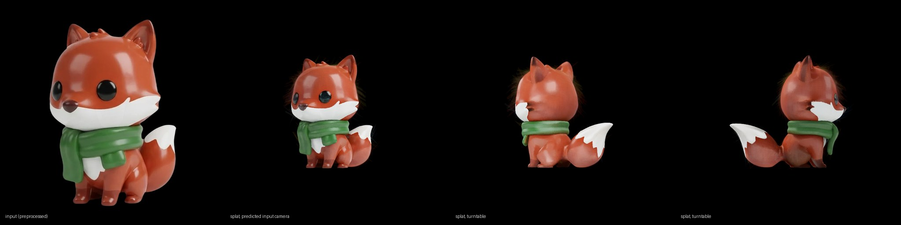

# ComfyUI-Idol

Native ComfyUI support for **[Idol](https://huggingface.co/speridlabs/idol)**, Speridlabs' single image to
3D gaussian splat model: one picture of an object in, a 3DGS splat (with the unseen sides) out, in a few
seconds on a modern GPU.

<p align="center"></p>

- **No requirements.** Pure ComfyUI. Nothing is installed, no model code is shipped.
- **Stock nodes.** Idol is the TripoSplat architecture retrained, and ComfyUI implements that natively, so the
  weights load with Load Diffusion Model and Load VAE and the stock TripoSplat nodes, KSampler, Render Splat,
  Save Splat and the 3D viewer run it. ComfyUI's offloading, dtypes, attention backends and `torch.compile`
  apply as usual.
- **Two nodes** for what Idol's pipeline adds on top: **Idol Preprocess Image** (its `synthetic` / `real`
  crop modes, background removal in place) and **Idol Camera** (the camera Idol predicts for the input, to
  re-render the input view or start a turntable from it).

## Install

Clone into `ComfyUI/custom_nodes` and restart ComfyUI:

```bash
cd ComfyUI/custom_nodes
git clone https://github.com/Nynxz/ComfyUI-Idol
```

Needs a ComfyUI with TripoSplat support (0.22 or newer).

## Models

| File | Folder | Size | Download |
|---|---|---|---|
| `idol_fp16.safetensors` | `models/diffusion_models` | 0.74 GB | [nynxz/Idol](https://huggingface.co/nynxz/Idol) |
| `idol_decoder_fp16.safetensors` | `models/vae` | 0.58 GB | [nynxz/Idol](https://huggingface.co/nynxz/Idol) |
| `dino_v3_vit_h.safetensors` | `models/clip_vision` | 1.68 GB | [VAST-AI/TripoSplat](https://huggingface.co/VAST-AI/TripoSplat/tree/main/clip_vision) |
| `flux2-vae.safetensors` | `models/vae` | 0.34 GB | [VAST-AI/TripoSplat](https://huggingface.co/VAST-AI/TripoSplat/tree/main/vae) |
| `birefnet.safetensors` | `models/background_removal` | 0.44 GB | [Comfy-Org/BiRefNet](https://huggingface.co/Comfy-Org/BiRefNet/tree/main/background_removal) |

The first two are Idol's own weights (the denoiser, and the octree + gaussian decoders) in ComfyUI's file
layout, made with [`scripts/convert.py`](#making-the-weights). The other three are the same encoders Idol
uses: DINOv3 ViT-H+/16 and the FLUX.2 VAE condition the denoiser, BiRefNet cuts the object out. If you
already run TripoSplat in ComfyUI you have them.

## Workflow

Drag **[example_workflows/idol_image_to_splat.json](example_workflows/idol_image_to_splat.json)** into
ComfyUI, or open it from **Templates → Custom Nodes → ComfyUI-Idol**. It is the standard TripoSplat graph
with the Idol files and the two Idol nodes:

| Node | Setting |
|---|---|
| Load Image | the object. A transparent PNG's own alpha can be used (see below) |
| Load Background Removal Model | `birefnet.safetensors` |
| **Idol Preprocess Image** | `mode` **synthetic** for renders and generated images, **real** for photographs |
| Load CLIP Vision | `dino_v3_vit_h.safetensors` |
| Load VAE | `flux2-vae.safetensors` → TripoSplat Conditioning |
| Load Diffusion Model | `idol_fp16.safetensors` |
| KSampler | `euler` / `simple`, **50** steps, cfg **4.0** |
| Load VAE | `idol_decoder_fp16.safetensors` → TripoSplat Decode |
| TripoSplat Decode | `num_gaussians` **262144** |
| **Idol Camera** → Render Splat | the splat from the predicted input camera: should look like the preprocessed image |
| Render Splat (72 frames) → Create Video | a turntable |
| Create 3D File (from Splat) → Save Splat | `.ply` (or `.spz`, ~10x smaller), shown in the 3D viewer |

Those KSampler values are Idol's defaults. Its `cfg_strength` 3.0 is `(1 + w) * cond - w * uncond`, which is
ComfyUI cfg **4.0**; its time shift `rescale_t` 3.0 is the model's sampling shift and already in the model
config, so no ModelSamplingSD3 node is needed; its 50 Euler steps on `linspace(1, 0)` are exactly
`euler` / `simple`. `dpmpp_2m` at 20 steps (the TripoSplat template's setting) is a faster trade-off.

**Tips**

- **Crop mode matters.** Idol was trained with the object spanning 1/1.2 of the frame for renders and
  generated images (`synthetic`) and 1/1.7 for photographs (`real`). `custom` sets the margin directly.
- **Transparent PNGs:** Idol uses an image's own alpha when it has one. In ComfyUI, Load Image's mask is the
  *transparent* region, so pass it through **Invert Mask** into Idol Preprocess Image's `mask`; the
  background removal model is then not needed.
- **Check the result from the input view.** Idol predicts the camera the input was taken from. Render Splat
  with Idol Camera's `camera_info` gives that view; if it does not resemble the preprocessed image something
  went wrong upstream (usually the mask or the crop mode).
- **Density:** 262144 gaussians matches the octree's point density. Higher values (up to 1048576) oversample
  the same points, so they are denser but add no detail and cost VRAM and time; 65536 is a fast preview.
- **Live preview:** the stock **TripoSplat Sampling Preview** node (in the workflow) shows a coarse decode at
  every step. Bypass it to save a little time.
- **Speed:** cond and uncond are batched, attention goes through ComfyUI's optimized attention, and the
  trunk runs in fp16 like the reference: on an RTX 5090 the 50 Euler steps take about 18 s and the 262144
  gaussian decode 4 to 8 s, without compilation. **TorchCompileModel** on the diffusion model works; the
  first run compiles. The decode scales with `num_gaussians`.
- **Exports:** Save Splat / Create 3D File write `.ply` (full 3DGS), `.spz` and `.ksplat`. The `.ply` is the same
  convention as Idol's own `save_ply` (y-up, degree-0 SH, log scale, logit opacity), so it opens in any
  splat viewer. **Extract Mesh from Splat** gives a GLB.

## Nodes

**Idol Preprocess Image**: IMAGE (+ MASK or BACKGROUND_REMOVAL) → IMAGE, MASK

What `idol.preprocess` does, on tensors: the short side is resized to 1024, the object's alpha (your mask, or
BiRefNet's prediction when none is connected) is eroded by `erode_radius` pixels so no background fringe
survives, a square of `mode` × the object's bounding box is cropped around it, resized to `size` × `size`
and composited on black. The `mask` output is the alpha in that frame.

**Idol Camera**: LATENT → LOAD3D_CAMERA, yaw, pitch, distance, fov

The denoiser denoises a 5-value camera token next to the object latent (direction, inverse distance,
half-width). This node decodes it from the KSampler output into a `camera_info` for Render Splat, Create
Camera Info and the 3D previews, plus yaw / pitch (degrees, Create Camera Info's orbit convention: yaw here is
180° minus Idol's yaw, pitch is the same), distance and vertical fov. Orthographic predictions become a far
perspective camera (distance 1000), like the reference.

## Making the weights

```bash
python scripts/convert.py                                    # downloads speridlabs/idol, writes ./out/
python scripts/convert.py --src /path/to/idol --out ComfyUI/models --dtype fp16
```

Idol's released files are the TripoSplat networks under their original parameter names, so the conversion is
only a file layout change:

- `denoiser.safetensors` → `diffusion_models/idol_fp16.safetensors`. The only key ComfyUI does not expect
  is `pos_pe`, the latent tokens' fixed Sobol positions; ComfyUI recomputes that buffer (`SobolEngine`,
  seed 123) and the script checks the stored one is identical before dropping it. The original fp32 file
  also loads directly (with an "unexpected key" warning).
- `decoder.safetensors` + `decoder_gs.safetensors` → `vae/idol_decoder_fp16.safetensors`, one file with the
  `octree.` and `gs.` prefixes ComfyUI's TripoSplat gaussian decoder is detected by. The gaussian
  representation config Idol ships (32 gaussians per anchor, softplus scaling with bias 0.004, opacity bias
  0.1, 0.0009 filter kernel, perturbation 1.5) is exactly ComfyUI's default for that decoder.
- `birefnet.safetensors` is Comfy-Org's BiRefNet without its training heads, so the stock file is used.

fp16 is the precision the reference runs the transformer trunks at; `--dtype bf16` and `fp32` also work.

## Tests

- `tests/parity.py` checks the ComfyUI path against the reference implementation
  ([idol-sdk](https://github.com/speridlabs/idol-sdk)) on random inputs: the denoiser's velocity for the
  latent and the camera, the octree decoder's logits, the gaussian decoder's activated gaussians and the
  PLY frame transform, the preprocessing and the camera decode. From the released fp32 weights the denoiser
  matches to 3e-6 relative error and the decoders to ~1e-4 to 3e-3 (ComfyUI's fused RMSNorm uses eps 1e-6 where
  the reference normalizes with none; with eps 0 they match exactly); the fp16 files add ~1e-3.
- `tests/e2e.py` runs the whole graph headless through the stock node classes and writes the `.ply`, the
  preprocessed input, the render from the predicted camera and a turntable sheet.

```bash
<ComfyUI>/.venv/bin/python tests/parity.py --comfy <ComfyUI> --ref <idol-sdk> --weights <released files> --converted <models dir>
<ComfyUI>/.venv/bin/python tests/e2e.py --comfy <ComfyUI> --image photo.png --out out --mode real
```

## Credits

[Idol](https://huggingface.co/speridlabs/idol) is by [Speridlabs](https://speridlabs.com/research/idol)
(Apache-2.0). It is the [TripoSplat](https://github.com/VAST-AI-Research/TripoSplat) architecture by
VAST-AI-Research, whose ComfyUI implementation runs it here. Image encoders: DINOv3 (Meta) and the FLUX.2 VAE
(Black Forest Labs); background removal: BiRefNet (Zheng et al.). Each has its own license. This pack is
Apache-2.0; see NOTICE.
